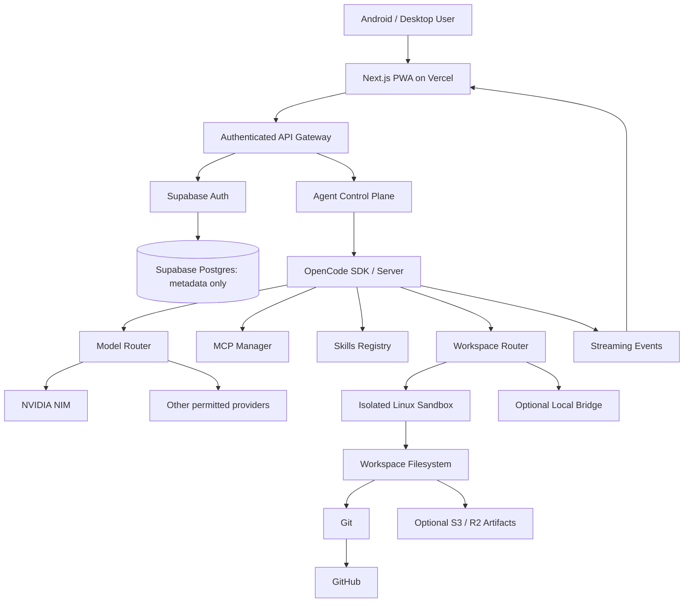

# Happyforge System Architecture

## High-level flow

## Component responsibilities

### Frontend
- Responsive installable PWA.
- Chat/task composer, session history, repository selector.
- Streaming agent events, terminal output and diffs.
- Explicit approval UI for sensitive actions.
- MCP, skills and provider settings.

### API and control plane
- Authenticate every request and authorize workspace ownership.
- Create and resume OpenCode sessions.
- Stream events to the correct user/session.
- Issue short-lived workspace credentials.
- Enforce quotas, timeouts and permission policies.

### Supabase
Store users, project metadata, session references, provider configuration metadata, permissions and usage records. Encrypt secrets with a server-side key or a dedicated secrets manager. Never store repositories, node_modules, build folders or large logs in Postgres/Storage by default.

### OpenCode
Reuse OpenCode for agent sessions, model interaction, tool execution, MCP and skill discovery. Pin and test a known version; isolate it per workspace or tenant boundary. Do not expose its server publicly without authentication.

### Workspace runtime
A separate Linux execution service owns repository checkout, filesystem, shell, dependency installation and tests. Apply CPU, RAM, disk, process, time and network limits. Use per-workspace isolation and ephemeral credentials. Vercel Functions and Supabase Edge Functions are not the long-running terminal host.

### Model routing
Start with one NVIDIA NIM credential and explicit model selection. Add provider adapters behind a common interface. Respect provider quotas and terms; retry with backoff and fail over only to separately permitted providers/credentials. Never rotate keys to evade rate limits.

### Storage
- GitHub: source of truth for code and history.
- Workspace disk: active checkout and temporary build state.
- R2/S3: optional snapshots and large artifacts.
- Supabase: metadata and references.

## Security boundaries
1. Browser never receives provider secrets, service-role keys or workspace credentials.
2. All workspace actions require user identity and workspace authorization.
3. MCP servers run in the workspace or as remote services; local browser code does not launch arbitrary processes.
4. Destructive commands, external network access and repository writes are policy-controlled.
5. Use Git checkpoints/branches before agent modifications.
6. Treat repository content, MCP output and skill packages as untrusted input.
