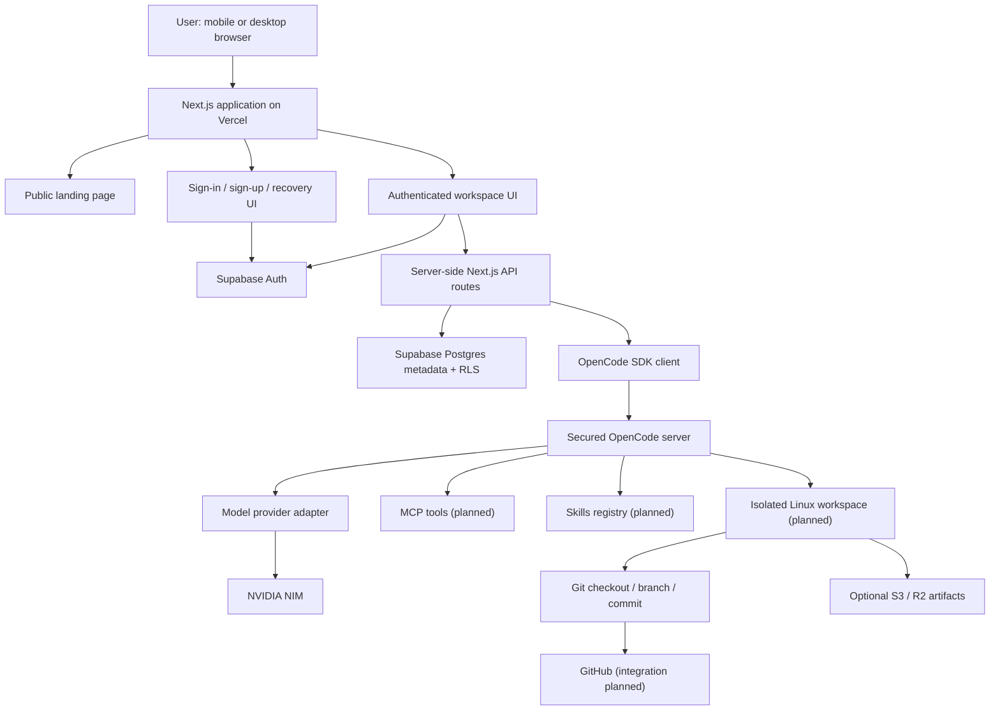
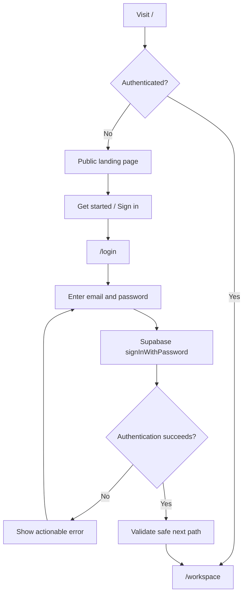
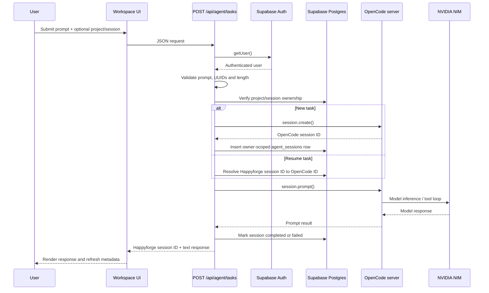
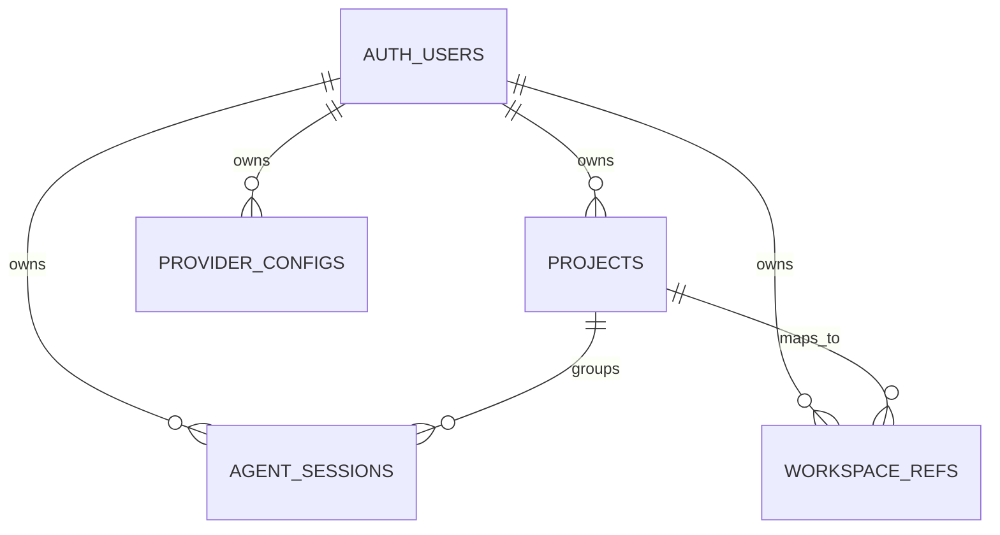

# Happyforge — Application Recreation Blueprint

> **Purpose:** This document is the product, behavior, architecture, and implementation blueprint for recreating Happyforge from the repository. It explains what the application is, why it exists, how its parts work together, what each current function does, and which product capabilities are still only planned.
>
> **Repository:** `animewar3000-dot/Happyforge`  
> **Reference branch:** `feat/interactive-auth-experience`  
> **Reference snapshot:** 10 November 2026  
> **Status:** Foundation + authenticated workspace + OpenCode request/response proof of concept. This is not yet a complete hosted AI IDE.

---

## 1. Product definition

Happyforge is a mobile-first AI software-development workspace. A user signs in, organizes projects, describes a coding task in natural language, and sends that task to an OpenCode agent running on a separately hosted, secured runtime. The agent uses a configured model provider (NVIDIA NIM is the initial provider) and returns a response to the workspace.

The product is designed to bring these concerns into one coherent developer environment:

- Project organization and repository context.
- AI coding-agent task composition and execution.
- Persistent session metadata and execution history.
- Model-provider configuration without exposing credentials to the browser.
- Extensible MCP tool connections.
- Reusable skills and project-level instructions.
- Isolated workspaces for repository and terminal operations.
- A consistent, responsive interface for desktop and mobile.

### Product promise

**Your IDE. Your agent. Your rules.**

Happyforge is the control surface and product experience. OpenCode is the agent engine. The application should not reimplement an agent engine when it can securely orchestrate an existing one.

### Why build it

Developer workflows are fragmented across editors, chat interfaces, model dashboards, terminals, repository tools, and agent configuration. Happyforge aims to make the workflow understandable and controllable:

1. The user explains the desired outcome.
2. The application creates or resumes an agent session.
3. The agent works in a controlled project workspace.
4. The user can inspect the task, result, status, and eventually diffs/tool activity.
5. Projects, sessions, model configuration, integrations, and reusable skills live in one place.

The product should prioritize user control, secure execution, portability, and transparent task status over pretending that every action is autonomous or already implemented.

---

## 2. Product boundaries and core principles

1. **OpenCode is the agent engine.** Happyforge owns the user experience, identity, metadata, policy and orchestration boundary.
2. **Supabase stores identity and metadata.** It is not the repository filesystem, build server, or long-running process host.
3. **GitHub is the source of truth for source code.** The active runtime checks out a repository into a workspace; the database stores repository references and ownership metadata.
4. **Agent execution is isolated.** Do not run persistent OpenCode processes, arbitrary shell commands, or repository builds inside Vercel request handlers.
5. **Secrets stay server-side.** Browser code must never receive NVIDIA API keys, OpenCode passwords, GitHub app secrets, Supabase service-role keys, or workspace credentials.
6. **Providers are pluggable.** NVIDIA NIM is the initial configured provider, not a permanent hard dependency.
7. **MCP and skills are explicit extension points.** Connections and tools need scopes, permission boundaries, and user-visible status.
8. **A visible control must have a real action or an honest disabled/coming-soon state.** Never substitute fake sample data or pretend a preview action executed.
9. **Treat external content as untrusted.** Repository files, model output, MCP responses and skill packages must not be treated as trusted instructions.
10. **Human review remains important.** Destructive actions, network access, repository writes and pull-request creation should be policy-controlled and reviewable.

---

## 3. Current implementation status

The repository contains working foundations and some deliberately unfinished product areas. Recreating the intended product means preserving this distinction.

| Area | Current state in reference branch | Notes |
|---|---|---|
| Public landing page | Implemented | Product story, feature cards, workflow explanation, architecture overview, responsive navigation |
| Sign in | Implemented | Supabase email/password authentication |
| Account creation | Implemented | Supabase sign-up; email confirmation may be required |
| Password recovery | Implemented | Recovery email, PKCE callback, authorized password update |
| Auth route protection | Implemented | Middleware checks Supabase claims and redirects |
| Workspace shell | Implemented | Responsive sidebar, mobile navigation, panels, status and feedback UI |
| Project metadata | Implemented | Create/list/delete project records in Supabase |
| Session metadata | Implemented | Load/list/filter sessions and show metadata |
| Agent health check | Implemented | Server checks secured OpenCode health endpoint |
| Agent task API | Implemented as proof of concept | Authenticated create/resume session and synchronous prompt/response |
| OpenCode SDK client | Implemented | Server-side Basic-authenticated SDK client |
| NVIDIA NIM config | Scaffolded | `opencode.json` configures a provider; a valid key and reachable host are required |
| Real cloud execution | Not verified end-to-end | Needs a deployed, secured runtime and isolated workspaces |
| Streaming events/tool activity | Not implemented | Current task API waits for a response |
| Full transcript retrieval | Not implemented in UI/API | Session history is metadata-focused |
| GitHub OAuth/App and repo import | Not implemented | Project stores optional repository URL only |
| Workspace provisioning and isolation | Planned | Workspace refs schema exists; provisioning adapter is not complete |
| MCP management | Placeholder UI | No registry/connection lifecycle yet |
| Skills management | Placeholder UI | No persistent skill registry/install workflow yet |
| User-managed model keys | Not implemented | Provider credentials belong on runtime host / secret manager |
| Multi-provider router | Planned | Provider config is a starting point only |
| Diff review / approval / push | Planned | No complete review-and-apply workflow yet |
| Usage, quotas, audit and abuse controls | Planned | Required before broad multi-user execution |

**Do not describe the application as a fully working cloud IDE until isolated execution, GitHub checkout, streaming, and a real end-to-end runtime test are complete.**

---

## 4. Technology stack

### Web application

- Next.js 15 App Router
- React 19
- TypeScript
- Tailwind CSS 3
- Motion for React (`motion/react`)
- Lucide React icons
- Node.js route handlers for server-side API operations

### Identity and metadata

- Supabase Auth
- Supabase Postgres
- Supabase SSR helpers and browser client
- Row Level Security (RLS) on user-owned metadata tables

### Agent execution

- OpenCode server
- Official OpenCode TypeScript SDK (`@opencode-ai/sdk`)
- NVIDIA NIM as the initial model provider
- Docker-based local runtime scaffold
- A separate Linux workspace/runtime host for persistent execution

### Delivery and integrations

- Vercel for the Next.js frontend/API layer
- GitHub for source control and future repository operations
- Docker Compose for local OpenCode runtime setup
- Optional S3-compatible object storage for artifacts/snapshots

---

## 5. System architecture

### 5.1 Logical architecture



### 5.2 Responsibility by layer

**Browser / frontend**
- Renders the landing page, authentication experience, and workspace.
- Collects user prompts and project metadata.
- Displays runtime state, errors, notices, sessions and projects.
- Calls only Happyforge's own server routes for agent execution.
- Uses the Supabase publishable key for browser authentication/data access under RLS.
- Never holds provider or runtime credentials.

**Next.js server layer**
- Reads and verifies the Supabase user session.
- Validates incoming task payloads.
- Checks project/session ownership.
- Connects to OpenCode using server-only credentials.
- Maps browser-visible Happyforge session IDs to OpenCode session IDs.
- Updates session metadata and returns a normalized response.
- Reports health without disclosing credentials.

**Supabase**
- Authenticates users and manages auth sessions.
- Stores project, agent-session, provider-config-reference and workspace-reference metadata.
- Enforces owner-scoped data access with RLS.
- Does not run the agent or store source repositories.

**OpenCode runtime**
- Owns agent session execution, model requests and tool orchestration.
- Runs outside Vercel request handlers.
- Must be protected by authentication and a private/TLS network boundary.
- Must be paired with per-user/per-workspace isolation before executing untrusted code.

**Workspace runtime**
- Future separate Linux service that clones repositories and owns filesystem, shell, dependency installation, tests and build artifacts.
- Applies CPU, memory, disk, process, time and network limits.
- Uses ephemeral, scoped credentials.
- Must not share an unrestricted host filesystem between users.

**GitHub**
- Future OAuth/App integration for repository authorization, clone, branch, commit, pull-request and synchronization workflows.
- Remains the canonical source history.

**NVIDIA NIM**
- Initial model provider configured in `opencode.json`.
- API key is provided to the OpenCode host through `NVIDIA_API_KEY`.
- Model ID availability and tool-calling support must be verified against the user's NVIDIA account.

---

## 6. Repository structure and what each part owns

The following is the reference branch structure, simplified to the important application files.

```text
Happyforge/
├── app/
│   ├── page.tsx                         # Public landing route
│   ├── layout.tsx                       # Root metadata, fonts, viewport and CSS
│   ├── globals.css                      # Global design system and page styles
│   ├── login/
│   │   └── page.tsx                     # Login route wrapper
│   ├── workspace/
│   │   └── page.tsx                     # Authenticated workspace and panels
│   ├── auth/
│   │   ├── callback/route.ts             # Supabase PKCE callback exchange
│   │   └── update-password/page.tsx      # Secure password update screen
│   └── api/
│       └── agent/
│           ├── health/route.ts            # OpenCode runtime health endpoint
│           └── tasks/route.ts             # Authenticated agent task endpoint
├── components/
│   ├── landing-page.tsx                  # Landing page composition
│   ├── happyforge-mark.tsx               # Shared four-tile brand mark
│   ├── ambient-scene.tsx                 # Workspace ambient background
│   └── ui/
│       └── modern-login-signup.tsx        # Sign-in / sign-up / recovery UI
├── lib/
│   ├── opencode.ts                       # Authenticated OpenCode SDK client
│   ├── auth-recovery.mjs                 # Recovery URL helpers
│   ├── auth-recovery.d.mts               # Type declarations for helper
│   └── supabase/
│       ├── client.ts                    # Browser Supabase client
│       └── server.ts                    # Server Supabase client
├── agent-runtime/
│   └── Dockerfile                        # Runtime container scaffold
├── agent-workspace/
│   └── .gitkeep                          # Dedicated local workspace mount
├── supabase/
│   └── migrations/
│       ├── 0001_initial_metadata.sql
│       ├── 0002_authenticated_metadata_access.sql
│       └── 20261110135332_index_project_foreign_keys.sql
├── tests/
│   └── auth-recovery.test.mjs            # Recovery helper tests
├── docs/
│   ├── ARCHITECTURE.md                   # Existing architecture notes
│   ├── DESIGN_SYSTEM.md                  # Visual and interaction rules
│   ├── OPENCODE_SETUP.md                 # Local/hosted OpenCode setup
│   ├── ROADMAP.md                        # Delivery milestones
│   ├── SUPABASE_SETUP.md                 # Supabase configuration
│   └── RECREATION_BLUEPRINT.md           # This full recreation guide
├── opencode.json                         # OpenCode NVIDIA provider config
├── docker-compose.yml                   # Local runtime composition
├── .env.example                          # Environment variable names only
├── package.json                          # Scripts and dependency manifest
├── middleware.ts                         # Auth route protection
└── README.md
```

### Main route responsibilities

- `/`: public product explanation and call-to-action. Authenticated users are redirected to `/workspace` by middleware.
- `/login`: sign in, create account, and request password reset.
- `/auth/callback`: exchange the Supabase one-time PKCE code for an authenticated cookie session; safely validate the `next` destination.
- `/auth/update-password`: verify an authenticated recovery session, validate the new password, and call Supabase Auth to update it.
- `/workspace`: authenticated application shell and all current product panels.
- `GET /api/agent/health`: checks whether the secured OpenCode host is configured and reachable.
- `POST /api/agent/tasks`: create or resume an OpenCode session, send a prompt, persist metadata and return the response.

---

## 7. User journeys and application flows

### 7.1 First visit and sign-in



### 7.2 Account creation and verification

1. User chooses **Create account**.
2. The UI validates email and password requirements.
3. The browser calls Supabase Auth `signUp`.
4. Supabase may send an email confirmation link, depending on project Auth settings.
5. The callback route exchanges the confirmation code for a session.
6. The user enters the workspace if a session is established; otherwise they return to sign in after confirmation.

### 7.3 Password recovery

1. User selects **Forgot password?**.
2. UI calls `resetPasswordForEmail` with a redirect URL generated by `buildPasswordRecoveryRedirect(origin)`.
3. Supabase sends a one-time recovery email.
4. Supabase redirects through `/auth/callback?next=/auth/update-password`.
5. Callback exchanges the PKCE code and sets the auth cookies.
6. Password update page calls `auth.getUser()` to verify the recovery session.
7. User enters and confirms a password (minimum 8 characters).
8. UI calls `auth.updateUser({ password })`.
9. On success, user can return to the workspace.

### 7.4 Workspace initialization

1. Middleware checks claims for protected routes.
2. Workspace calls `loadWorkspace()`.
3. It verifies the current Supabase user.
4. It loads projects and the latest 30 agent-session metadata rows.
5. It calls `GET /api/agent/health`.
6. Runtime status becomes one of `checking`, `online`, `unavailable`, or `not-configured`.
7. UI enables task submission only when runtime is online.

### 7.5 Agent task execution (current proof of concept)



**Current limitations:** This is request/response, not token streaming. The workspace does not yet expose a full persisted transcript, live tool events, workspace diff, approval workflow, or repository operations. The current runtime must be configured and reachable; a successful frontend build does not prove agent execution.

---

## 8. Function map

This section maps the actual named functions and their responsibilities in the reference branch. It is a guide for recreation, not a claim that all planned product features already exist.

### 8.1 Authentication UI — `components/ui/modern-login-signup.tsx`

| Function / state | Responsibility |
|---|---|
| `ModernLoginSignup()` | Owns sign-in, sign-up and recovery form state; renders the auth experience |
| `changeMode(next)` | Switches between `signin`, `signup`, and `recovery`; clears stale errors/messages/password |
| `submit(event)` | Validates and dispatches the appropriate Supabase Auth operation |
| `strength` (memoized value) | Computes the password-strength meter for sign-up |
| Canvas effect | Draws the decorative auth background; not part of authentication logic |

**Submit behavior**
- Recovery: `supabase.auth.resetPasswordForEmail(email, { redirectTo })`.
- Sign-up: `supabase.auth.signUp({ email, password, options: { emailRedirectTo } })`.
- Sign-in: `supabase.auth.signInWithPassword({ email, password })`.
- Successful sign-in validates the requested `next` path to prevent protocol-relative redirects, then navigates to that path or `/workspace`.
- Errors are displayed in the form; busy state is always cleared in `finally`.

### 8.2 Password update — `app/auth/update-password/page.tsx`

| Function / effect | Responsibility |
|---|---|
| Auth-check effect | Calls `auth.getUser()` to determine whether a valid recovery session exists |
| `submit(event)` | Checks password equality and minimum length, then calls `auth.updateUser({ password })` |
| Completion state | Clears password inputs and shows a success state |
| Invalid/expired state | Tells user to request a new recovery link |

### 8.3 Workspace — `app/workspace/page.tsx`

| Function / value | Responsibility |
|---|---|
| `WorkspacePage()` | Owns the workspace shell, active panel, project/session state and UI feedback |
| `dateLabel(value)` | Formats database timestamps for display |
| `statusTone(status)` | Maps status to a semantic visual tone |
| `Badge()` | Reusable status badge |
| `loadWorkspace()` | Verifies the current user and loads projects + latest session metadata |
| `checkRuntime()` | Calls `/api/agent/health` and maps result to runtime state |
| `visibleSessions` | Filters sessions by selected project and search query |
| `sendTask(event)` | Validates UI state, submits task to agent API, renders response and refreshes metadata |
| `createProject(event)` | Inserts a project metadata row with current owner ID |
| `deleteProject(project)` | Confirms deletion, deletes the row, and updates local selection/state |
| `newTask()` | Clears current prompt/conversation/session selection and returns to workspace panel |
| `requestPasswordReset()` | Sends a recovery email for the signed-in user's email |
| `signOut()` | Calls Supabase `signOut()` and navigates to login |
| `openSession(session)` | Selects session metadata and opens session history detail |
| `statusLabel` | Human-readable labels for created/running/waiting_approval/completed/failed/archived |

**Workspace panels**
- **Workspace:** task composer, prompt suggestions, project selector, recent sessions, toolkit status cards.
- **Agent sessions:** searchable session list and metadata details.
- **Projects:** create/list/select/delete project metadata.
- **MCP integrations:** informational cards for GitHub, Supabase, filesystem and web research; connection lifecycle is not implemented.
- **Skills library:** placeholder explaining that persistent skill management is the next module.
- **Models & keys:** explains that provider credentials live on the secured runtime host; no browser key form.
- **Account:** signed-in email, session-security explanation, password reset and sign out.

### 8.4 Agent API — `app/api/agent/tasks/route.ts`

| Function / constant | Responsibility |
|---|---|
| `MAX_PROMPT_LENGTH` | Enforces a 12,000-character prompt limit |
| `UUID_PATTERN` | Validates optional session/project identifiers |
| `extractText(result)` | Extracts text parts from the OpenCode SDK prompt response |
| `POST(request)` | Authenticates user, parses/validates payload, verifies ownership, creates or resumes OpenCode session, sends prompt, persists status and returns JSON |

**Request shape**
```json
{
  "prompt": "Explain this repository and identify the entry points.",
  "sessionId": null,
  "projectId": null
}
```

- `prompt` is required, non-empty and at most 12,000 characters.
- `sessionId` is optional and must be a UUID for an existing owner-scoped Happyforge session.
- `projectId` is optional and must be a UUID for a project owned by the signed-in user.

**Success response**
```json
{
  "sessionId": "happyforge-agent-session-uuid",
  "response": "Agent response text"
}
```

**Error behavior**
- 401: no authenticated user.
- 400: invalid JSON, empty prompt, or invalid identifier.
- 413: prompt exceeds the length limit.
- 404: project or session does not exist for this user.
- 502: OpenCode/runtime execution failure (client receives a safe generic error).
- A session that has been created is marked `failed` when task execution throws.

**Important ownership rule:** Browser-visible Happyforge session UUIDs are not raw OpenCode session IDs. The server resolves the mapping through `agent_sessions` filtered by `owner_id`. Never accept a raw OpenCode session ID from the browser.

### 8.5 Runtime health — `app/api/agent/health/route.ts`

| Function | Responsibility |
|---|---|
| `GET()` | Checks required runtime environment variables; if configured, sends authenticated request to OpenCode `/global/health` with a 5-second timeout |

Returns a small status object with `configured`, `connected`, and status information. It must not return the runtime URL credentials or model key. The current route is a status probe, not an agent task endpoint.

### 8.6 OpenCode client — `lib/opencode.ts`

| Function | Responsibility |
|---|---|
| `requiredEnv(name)` | Throws a clear server-side error when a required environment variable is missing |
| `getOpenCodeClient()` | Creates the OpenCode SDK client with Basic auth injected into server-side fetch; uses `throwOnError: true` |

The module must only be imported by server-side code. Never import it into a client component.

### 8.7 Supabase clients

- `lib/supabase/client.ts`: creates the browser Supabase client using the project URL and publishable key.
- `lib/supabase/server.ts`: creates the server Supabase client with request cookies for authenticated server operations.
- `middleware.ts`: refreshes/reads Supabase claims, redirects unauthenticated users away from protected paths, and redirects signed-in users from `/` to `/workspace`. Public paths include `/`, `/login`, and `/auth/*`.

### 8.8 Other UI functions

- `LandingPage()` in `components/landing-page.tsx`: public product page, responsive navigation, feature cards, task-to-review story, architecture summary and CTA.
- `AmbientScene()` in `components/ambient-scene.tsx`: decorative pointer-reactive orb/grid scene using Motion; respects reduced-motion preference.
- `HappyforgeMark()` in `components/happyforge-mark.tsx`: shared four-tile brand identity.

---

## 9. Data model

The Supabase schema is metadata-oriented. It must not become a substitute for Git or a workspace filesystem.

### `projects`

| Column | Meaning |
|---|---|
| `id` | UUID primary key |
| `owner_id` | Supabase Auth user ID |
| `name` | User-facing project name |
| `repository_url` | Optional Git repository URL |
| `default_branch` | Default branch name, initially `main` |
| `created_at`, `updated_at` | Timestamps |

### `agent_sessions`

| Column | Meaning |
|---|---|
| `id` | Happyforge metadata UUID exposed to the browser |
| `owner_id` | Owning Supabase user |
| `project_id` | Optional relation to `projects`; set null if project is deleted |
| `opencode_session_id` | Internal OpenCode session identifier; never expose as the browser's authorization token |
| `title` | Prompt-derived session title |
| `status` | created, running, waiting_approval, completed, failed, archived |
| `created_at`, `updated_at` | Timestamps |

### `provider_configs`

Stores provider metadata and a `secret_reference`, not raw API keys. Actual secret material belongs in a dedicated secret manager or protected runtime environment.

### `workspace_refs`

Maps a user-owned project to an external runtime workspace identifier, status and optional expiry. This is a reference table; it does not itself provision or isolate the workspace.

### Relationships



### Row-level security

All four tables have RLS enabled. Policies restrict access to rows where `auth.uid() = owner_id`, and Data API grants are for the authenticated role. Anonymous table access is revoked. Keep these protections when adding tables or RPC functions; test both allowed owner access and rejected cross-user access.

---

## 10. Runtime and model configuration

### OpenCode

The web app is an OpenCode client. The runtime must be a separate persistent service.

The repository contains:
- `opencode.json`: OpenCode provider/model configuration.
- `agent-runtime/Dockerfile`: runtime container scaffold.
- `docker-compose.yml`: local runtime composition.
- `agent-workspace/`: dedicated workspace mount.

Local setup is documented in [OPENCODE_SETUP.md](./OPENCODE_SETUP.md). In summary:

1. Copy `.env.example` to local environment files.
2. Set `NVIDIA_API_KEY` and a long random `OPENCODE_SERVER_PASSWORD` on the runtime host.
3. Start the Docker Compose runtime.
4. Configure the Next.js server with the OpenCode URL, username and same password.
5. Verify the authenticated health endpoint.
6. Submit a simple prompt against a disposable test repository.

### NVIDIA NIM

The current `opencode.json` configures:
- Provider name: NVIDIA NIM.
- OpenAI-compatible base URL: `https://integrate.api.nvidia.com/v1`.
- Model ID: `nvidia/deepseek-ai/deepseek-v4-flash`.
- API key lookup: `{env:NVIDIA_API_KEY}`.

Treat this as a configurable starting point. Verify model availability, quota and tool-calling compatibility before relying on it.

### Environment variables

Names from `.env.example`:

| Variable | Where it belongs | Purpose |
|---|---|---|
| `NEXT_PUBLIC_APP_URL` | Web app | Canonical app URL |
| `NEXT_PUBLIC_SUPABASE_URL` | Web app | Supabase project URL |
| `NEXT_PUBLIC_SUPABASE_PUBLISHABLE_KEY` | Browser-safe web config | Supabase publishable key |
| `OPENCODE_SERVER_URL` | Web server | Secured OpenCode host URL |
| `OPENCODE_SERVER_USERNAME` | Web server | OpenCode Basic-auth username |
| `OPENCODE_SERVER_PASSWORD` | Web server + runtime | Shared runtime authentication secret |
| `NVIDIA_API_KEY` | Runtime host only | NVIDIA NIM credential |
| `GITHUB_CLIENT_ID` | Server-side | Future GitHub OAuth/App integration |
| `GITHUB_CLIENT_SECRET` | Server-side | Future GitHub OAuth/App integration |
| `S3_ENDPOINT`, `S3_REGION`, `S3_BUCKET`, `S3_ACCESS_KEY_ID`, `S3_SECRET_ACCESS_KEY` | Server-side artifact adapter | Optional object storage |

Never prefix a secret with `NEXT_PUBLIC_`. Never commit actual `.env` files or secret values.

---

## 11. Visual and interaction system

The source of truth is [DESIGN_SYSTEM.md](./DESIGN_SYSTEM.md).

### Visual direction

**Graphite engineering studio**: dark, focused, technical and premium rather than a generic chatbot.

- Near-black graphite background and layered charcoal surfaces.
- Acid/lime accent for primary action and active states.
- Violet and cyan as secondary accents.
- Geist for interface text, Doto for expressive display headlines, Geist Mono for technical metadata.
- Shared four-tile Happyforge mark (lime, violet, cyan, graphite).
- Fine borders, restrained translucent surfaces, careful spacing and subtle depth.
- Motion supports hierarchy and feedback, never blocks task entry or scrolling.

### Interaction rules

- Every button must work or clearly say it is unavailable/upcoming.
- Runtime status is communicated with both text and visual indicator.
- Forms have labels, validation, accessible errors and busy states.
- Mobile navigation is first-class; no horizontal overflow.
- Keyboard focus must be visible.
- Respect `prefers-reduced-motion`.
- Do not invent sessions, projects, successful model tests, connected MCP servers or task results.

---

## 12. Security and reliability requirements

These are requirements for any faithful recreation and for future production readiness.

### Identity and authorization
- Verify the user on every protected server operation.
- Check project and session ownership server-side; do not rely only on hidden UI state.
- Use RLS on every user-owned table.
- Validate redirect destinations to prevent open redirects.
- Do not expose raw OpenCode session IDs to clients.

### Secret handling
- Keep NVIDIA, GitHub, OpenCode and workspace secrets on trusted server/runtime infrastructure.
- Use a secret manager or encrypted secret references for per-user provider credentials.
- Never log secrets or return them in error messages.
- Rotate credentials through explicit administrative workflows, not to bypass quotas.

### Execution isolation
- Do not execute untrusted repository code on a shared unrestricted host.
- Give each user/project an isolated workspace or equivalent strong tenant boundary.
- Limit CPU, memory, disk, process count, duration and network egress.
- Use short-lived repository credentials.
- Keep the OpenCode server behind private networking or authenticated TLS proxy.
- Apply permission policies to shell, filesystem, network, MCP and Git operations.
- Create Git checkpoints/branches before agent modifications.

### Reliability
- Set timeouts on runtime requests.
- Use bounded retries with backoff for transient failures.
- Persist lifecycle state transitions and useful error metadata.
- Distinguish runtime-not-configured from runtime-unavailable.
- Add idempotency for task creation before retrying requests automatically.
- Add audit logs, rate limits, usage accounting and abuse controls before public multi-user execution.

---

## 13. Recreation plan — build in this order

### Phase 1 — Foundation and public UI
1. Create Next.js App Router project with TypeScript and Tailwind.
2. Add root layout, metadata, fonts and global design tokens.
3. Implement shared brand mark and ambient scene.
4. Build responsive landing page and login route.
5. Add CI, lint, typecheck and build scripts.

**Done when:** public route, responsive nav, login entry and visual system work on desktop and mobile.

### Phase 2 — Authentication
1. Create Supabase browser and server clients.
2. Configure email/password Auth and redirect URLs.
3. Implement sign-in and sign-up.
4. Implement callback code exchange.
5. Implement password recovery and password update.
6. Add middleware protection and safe return paths.
7. Test invalid credentials, unverified email, expired recovery, network errors and sign-out.

**Done when:** a real user can sign up, verify, sign in, recover password, access protected pages and sign out.

### Phase 3 — Metadata and workspace shell
1. Apply schema migrations for projects, sessions, provider references and workspace references.
2. Enable RLS and authenticated-only grants.
3. Build responsive workspace shell and seven panels.
4. Load projects and sessions from Supabase.
5. Implement create/select/delete project metadata.
6. Implement session search, filtering and detail metadata.
7. Add loading, empty, error and success states.

**Done when:** data belongs to the signed-in user and cross-user reads/writes are denied.

### Phase 4 — OpenCode proof of concept
1. Add the official OpenCode SDK.
2. Implement server-only authenticated client.
3. Deploy or start a persistent OpenCode host.
4. Configure NVIDIA NIM on that host.
5. Add health endpoint.
6. Add authenticated task endpoint with payload validation and ownership checks.
7. Create/resume sessions and persist mapping to Supabase.
8. Test one prompt end-to-end in a disposable workspace.

**Done when:** a real signed-in user can submit a task and receive an actual OpenCode response; a missing or offline runtime is shown honestly.

### Phase 5 — Real workspace execution
1. Define a workspace adapter interface.
2. Provision isolated per-user/per-project Linux workspaces.
3. Implement GitHub OAuth/App installation and repository authorization.
4. Clone repositories into workspaces and manage branches.
5. Add controlled filesystem and terminal tools.
6. Add test/build execution and resource limits.
7. Capture diffs and require approval before push.

**Done when:** agent work is isolated, reproducible, auditable and reviewable.

### Phase 6 — Streaming and session continuity
1. Add OpenCode event subscription/stream transport.
2. Stream token output and tool lifecycle events to the correct session.
3. Persist messages/events or a durable transcript.
4. Add cancel, retry and resume behavior.
5. Show file changes, command output, approvals and final summary.

**Done when:** the UI reflects the real task lifecycle instead of waiting for one final response.

### Phase 7 — MCP, skills and model settings
1. Implement MCP registry and connection lifecycle.
2. Add per-project allowlists and approval policies.
3. Define portable skill package format and metadata.
4. Add global/project skill assignment and versioning.
5. Implement provider configuration through secret references/secret manager.
6. Add provider/model validation and health checks.
7. Add quotas and usage tracking.

**Done when:** extensions are manageable, scoped, secure and genuinely used by the runtime.

### Phase 8 — Production hardening
1. Add tenant isolation tests and authorization regression tests.
2. Add rate limiting, audit logs, abuse controls and quotas.
3. Add backups and operational monitoring.
4. Add dependency scanning and secret scanning.
5. Test recovery, deploy rollback and runtime failure scenarios.
6. Verify mobile accessibility and reduced motion.
7. Document incident response and data retention.

---

## 14. Minimum acceptance tests

- Anonymous user cannot load `/workspace` or call `POST /api/agent/tasks`.
- Signed-in user cannot read, resume, or mutate another user's project/session.
- Malformed JSON, empty prompts, oversized prompts and invalid UUIDs are rejected.
- Runtime missing credentials reports not configured; unreachable runtime reports unavailable.
- Browser bundle contains no NVIDIA/OpenCode/GitHub secret.
- Password reset redirect returns to the password update page with a valid recovery session.
- Invalid or expired recovery link cannot change a password.
- Project creation/deletion updates Supabase and the UI consistently.
- A successful task creates a Happyforge session metadata row and maps it to one OpenCode session.
- Failed task marks session failed and never displays a false success.
- Mobile layout supports all workspace panels without horizontal overflow.
- Reduced-motion preference disables nonessential animated behavior.

---

## 15. Known gaps and next engineering priorities

The highest-priority gaps between the current reference branch and the complete product vision are:

1. **Runtime deployment and isolation:** a reachable OpenCode server is not enough; code execution needs tenant-isolated workspaces.
2. **End-to-end verification:** test the actual deployed web app against a secured OpenCode host and a valid NVIDIA NIM credential.
3. **Project-to-repository workflow:** GitHub authorization, clone, branch and workspace routing are not complete.
4. **Streaming and transcripts:** current endpoint is synchronous and the UI states that full transcript/live steps are not exposed.
5. **MCP lifecycle:** connection setup, health, scopes, approvals and tool execution need implementation.
6. **Skills lifecycle:** package discovery, installation, project assignment and versioning need implementation.
7. **Model/secret management:** provider credentials need secure storage and model health/usage controls.
8. **Production safeguards:** quotas, audit logs, abuse prevention, backups and runtime monitoring.

The existing roadmap in [ROADMAP.md](./ROADMAP.md) is the milestone checklist. This blueprint explains the intended behavior and the boundaries each milestone must respect.

---

## 16. Source files to inspect when recreating

- [Landing page](../components/landing-page.tsx)
- [Workspace](../app/workspace/page.tsx)
- [Authentication UI](../components/ui/modern-login-signup.tsx)
- [Password update page](../app/auth/update-password/page.tsx)
- [Auth callback](../app/auth/callback/route.ts)
- [Auth middleware](../middleware.ts)
- [Agent task API](../app/api/agent/tasks/route.ts)
- [Agent health API](../app/api/agent/health/route.ts)
- [OpenCode SDK client](../lib/opencode.ts)
- [Supabase browser client](../lib/supabase/client.ts)
- [Supabase server client](../lib/supabase/server.ts)
- [Database migrations](../supabase/migrations/)
- [OpenCode configuration](../opencode.json)
- [Runtime setup](./OPENCODE_SETUP.md)
- [Supabase setup](./SUPABASE_SETUP.md)
- [Design system](./DESIGN_SYSTEM.md)
- [Roadmap](./ROADMAP.md)

---

## 17. Final recreation principle

Recreate Happyforge as a **secure agent-workspace platform**, not merely as a dark dashboard with a prompt box.

The interface, auth, project/session metadata, runtime boundary, model provider, repository workspace, MCP tools, skills and review flow are separate responsibilities. Connect them through explicit server-side contracts. Keep the working authentication and metadata behavior intact while progressively replacing placeholders with real services. Every claimed capability must be backed by a tested implementation.
